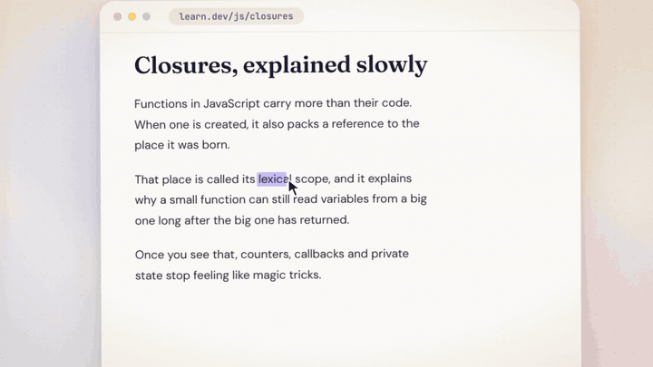
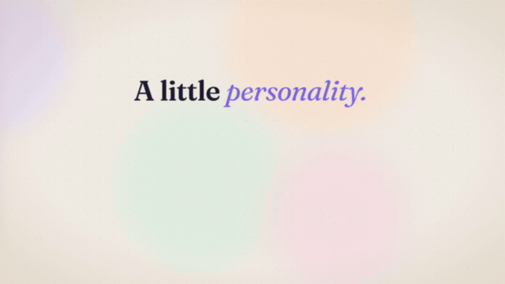
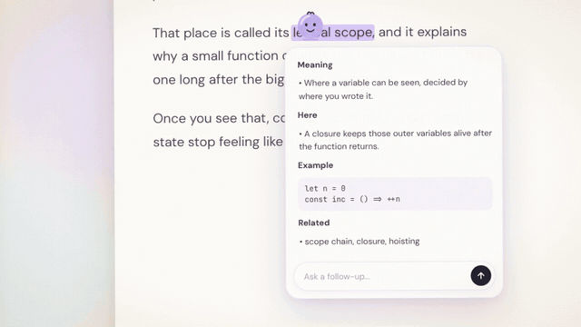
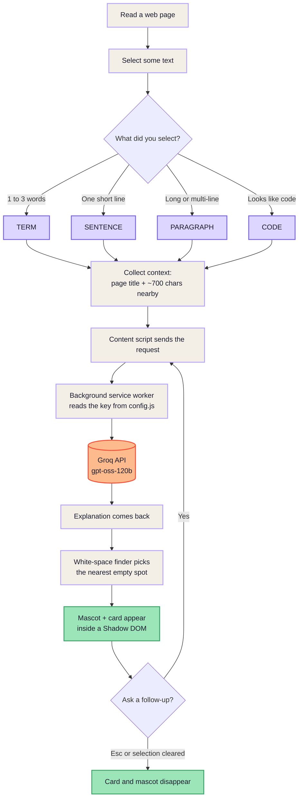
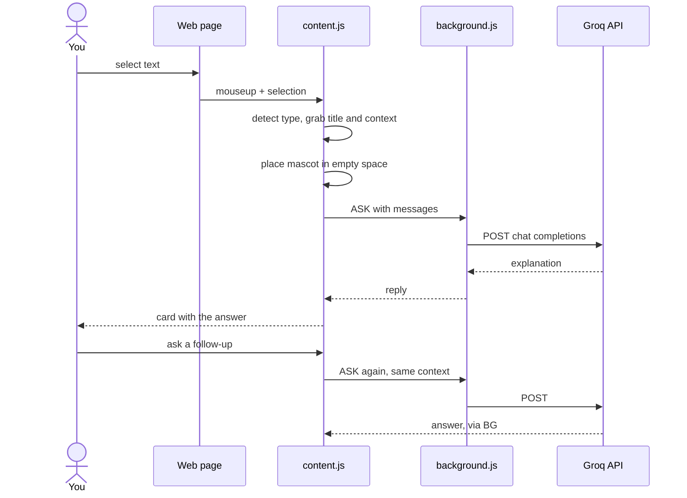

<div align="center">



<br>

**Stop opening a new tab every time you hit a word you don't know.**

<a href="https://github.com/irti-11/explain-agent"></a>

<p>
  
  
  
  
  
</p>



</div>

---

## The story

I was working through a course and an article, and every few minutes I hit a word I didn't know. Open a tab, Google it, read three results, lose my place.

Everyone has built a tool like this. I know. I built it anyway, because the problem was mine, and building for yourself means you notice every flaw and fix the things that matter.

Explain Agent keeps the explanation on the page you're reading.

## Before and after

| Without it | With it |
|---|---|
| See an unknown word | See an unknown word |
| Open a new tab and search | **Select it** |
| Skim three explanations | Read one, written for *this* page |
| Find your place again | You never left |

## What it does

- **Auto explain.** Select text and it answers. No button, no prompt box.
- **Knows what you selected.** A term, a sentence, a paragraph or code each get a different style of explanation.
- **Page aware.** It sends the page title and about 700 characters around your selection, so the answer fits what you're reading.
- **Follow-ups.** Ask a question in the same card. The selected text stays as context.
- **A mascot with moods.** Nine of them, and its eyes follow your mouse.
- **White-space finder.** It measures the text, images and buttons on screen and moves to the nearest empty spot, so it never covers what you're reading.
- **Gets out of the way.** Clear the selection or press `Esc` and it's gone.
- **Shadow DOM.** The website's CSS can't break the UI.

## See it move

| Mascot moods | White-space finder |
|:---:|:---:|
|  |  |
| It reacts to what's happening. | It looks for empty space instead of covering your text. |

## It adapts to what you select

| You select | It's treated as | You get |
|---|---|---|
| `API` | term | Plain meaning, what it means here, a tiny example, related terms |
| `What is an API?` | sentence | The meaning in simple words, every hard term explained |
| A longer block of text | paragraph | The big idea, then step by step, then a one-line summary |
| A code snippet | code | What it does, line by line, and one common mistake |

## Meet the mascot

| Face | Mood | When |
|:---:|---|---|
| `( ◕ ‿ ◕ )` | Happy | An explanation is ready |
| `( ◔ _ ◔ )` | Thinking | The answer is loading |
| `( ✧ ▽ ✧ )` | Excited | The answer just landed |
| `( ⊙ o ⊙ )` | Surprised | You selected something |
| `( ◕ ‿ - )` | Wink | Now and then, for no reason |
| `( ◕ ᴗ ◕ )` | Listening | You're typing a follow-up |
| `( > ▽ < )` | Tongue out | You clicked it |
| `( ᴗ _ ᴗ ) z` | Sleepy | 25 seconds of nothing |
| `( ╥ _ ╥ )` | Sad | Something broke |

## How it works



And the same thing as a conversation between the parts:



- **Shadow DOM** keeps the card and mascot isolated from the page's CSS.
- **Service worker** sends the selection and context to Groq.
- **White-space finder** collects the bounding boxes of visible text, images and buttons, then picks the nearest free spot.

## Install

```bash
git clone https://github.com/irti-11/Explain_Agent
cd Explain_Agent
```

**1. Add your key.** Copy the example config and paste in your own Groq key:

```bash
cp config.example.js config.js      # Windows: copy config.example.js config.js
```

```js
// config.js
const GROQ_API_KEY = "gsk_...";
```

`config.js` is listed in `.gitignore`, so your key never gets committed.

**2. Load it into Chrome.**
Open `chrome://extensions`, turn on **Developer mode**, click **Load unpacked** and pick the project folder.

**3. Use it.** Open any normal web page, select some text and watch the orb show up.

<details>
<summary><b>Limitations</b></summary>

It doesn't work on `chrome://` pages, the Chrome Web Store or Chrome's built-in PDF viewer. The free Groq tier has rate limits, so if you hit one, wait a bit and try again.

</details>

<details>
<summary><b>Privacy and your API key</b></summary>

Each request sends Groq the text you selected, the page title and about 700 characters of surrounding text. Nothing else.

Your key lives in `config.js`, which Git ignores. It is still a plain file inside the extension folder, so don't share the folder or publish a build with your key in it. For a public release, put a small proxy server in front of Groq so the key stays on the server.

</details>

## Under the hood

| | |
|---|---|
| Language | Vanilla JavaScript |
| Platform | Chrome Extension, Manifest V3 |
| Model | `openai/gpt-oss-120b` on Groq |
| UI isolation | Shadow DOM |
| Build step | None |

```text
explain-agent/
├── assets/            banner and demo GIFs
├── background.js      service worker, calls Groq
├── content.js         selection, card, mascot, white-space finder
├── config.example.js  copy to config.js and add your key
├── manifest.json
└── README.md
```

## Roadmap

- [ ] Settings page
- [ ] Save explained words to notes
- [ ] Explain screenshots and images
- [ ] Hold-to-activate shortcut
- [ ] Dark mode
- [ ] Streaming answers
- [ ] Chrome Web Store release (with a key-hiding proxy)

## Contributing

Pull requests are welcome. Fork the repo, make a branch, test it in Chrome and open a PR with a clear description. Please never commit `config.js` or any API key.

## License

MIT. See [LICENSE](LICENSE).

---

<div align="center">

Made by **[Irtiza](https://github.com/irti-11)** in Karachi.

If Explain Agent saves you a few tabs, a ⭐ would make my day.

</div>